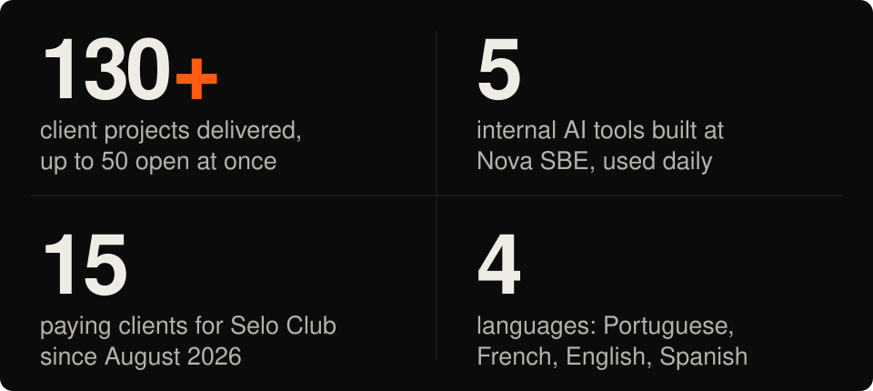
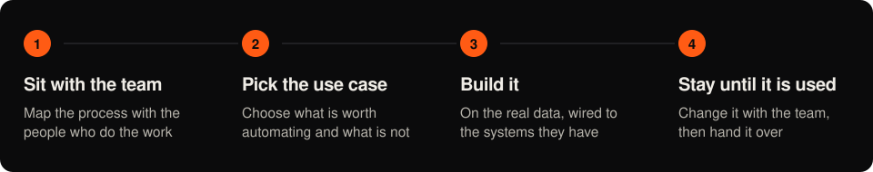

## Hi, I'm Diogo

I'm **PMO for Strategy at Nova SBE** in Lisbon. I run the project portfolio of the Faculty and Research pillar and lead its AI transformation, and I build the tools myself. On the side I founded **Selo Club** and built **Renderly**.

Engineer by training, strategist by trade. Most of my time goes into one question: how do you get a team to actually use AI in its daily work?

## What I build

<table>
<tr>
<td width="50%" valign="top">

### Selo Club

Loyalty cards that live in the phone's Wallet, for local businesses. Nothing for the customer to install. I designed it, built it and sell it, one counter at a time.

**Status:** live since August 2026, 15 paying clients, staff scanner app on Google Play 
**Stack:** Next.js, Supabase, Stripe, Apple PassKit, Google Wallet API

</td>
<td width="50%" valign="top">

### Renderly

An API that turns HTML into a PDF in one call. For developers who need invoices, reports or certificates out of their apps.

**Status:** live, with dashboard, docs and a free tier 
**Stack:** Node.js, Fastify, Chromium

 &nbsp; [Source code](https://github.com/diogoberger/renderly)

</td>
</tr>
</table>

Most of my other code is private: Selo Club itself, three client websites that are live and taking customers, and the internal tools I build at work.

## AI at work

At Nova SBE I mapped the processes of three teams, chose the use cases with them and built **five internal tools they now use every day**. One replaced a separate spreadsheet for every academic year with a single dashboard. Another turned a payments workbook into one tool with built-in rule checks.

This is how I run every one of those projects:

In July 2026 I led the team that **won the Nova SBE AI Hackathon** (two days, 250+ participants). We built Alumni Companion: a platform that keeps alumni connected to the school, matches mentors and mentees, and has an AI chat for career questions. The school is now building it for launch.

## Learning

- **Postgraduate in AI and Data for Business**, Nova SBE Executive Education (in progress, alongside a full-time job)
- **Anthropic Academy:** AI Fluency, Claude Platform 101, Claude Code in Action, Claude Code 101, Claude 101
- **OpenAI Academy:** AI Leadership, Scope AI Solutions
- **Master in Management**, Digital Business track, IE Business School, Madrid
- **BEng Mechanical Engineering**, Coventry University, England

## Toolkit

| Area | What I use |
|---|---|
| AI | Claude, Claude Code, use case discovery, process automation, AI tool building |
| Build | Next.js, Supabase, Stripe, REST APIs, Apple and Google Wallet APIs, Vercel, SQL (basic) |
| Work | Portfolio and program management, process mapping, workshop facilitation, executive reporting |

## Get in touch

If you have a team that should be working with AI and is not yet, I'd like to hear about it.

